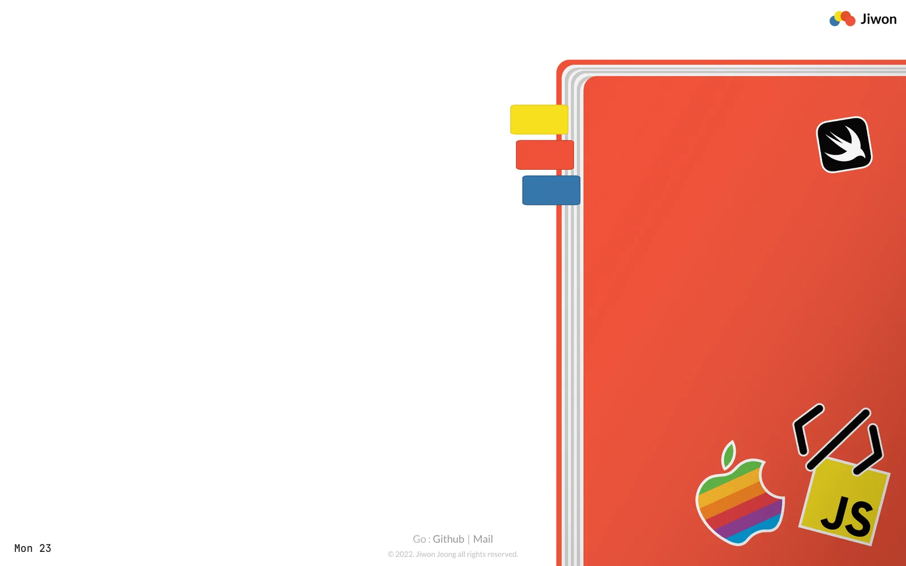

# 🔖 Bookmark-style Main Page

**책갈피를 넘기는 듯한 디자인의 자기소개 페이지 (1세대)**

## 소개

책 표지 옆에 꽂힌 색색의 책갈피를 눌러 About Me · My Works · Work Blogs 페이지로 넘어가는 자기소개 페이지입니다. 2022년에 처음 만든 개인 홈페이지입니다.

## 실행

`index.html`을 브라우저로 열면 됩니다.

> 현재 포트폴리오는 [jiwonsudo.github.io/portfolio](https://jiwonsudo.github.io/portfolio/)에서 볼 수 있습니다.
